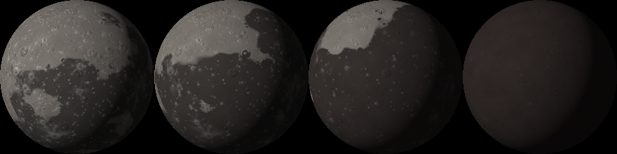

# Showoff

Planet looks, each baked on the CPU from its texture graph with simple lighting and rough relief
shading. These are not client screenshots: the client adds the relief path's crater lighting,
air, haze and clouds.

## Icy moons

`worlds/icy.tgraph` with `lc_world::icy`. Left to right: Europa, Ganymede, Callisto, Enceladus
and Triton from the measured table, then three generated moons: a cold Ganymede-sized one, a
tidally heated mid-sized one, and a small one at 40 K.

## Captured moons

`worlds/airless.tgraph`. Left to right: Luna, a generated airless rock, then three captured
moons with the dark rubble preset from `lc_world::airless::rubble`.

## Lava worlds

`worlds/airless.tgraph` with `lc_world::airless::molten`. One generated scorched planet at
800, 1,100, 1,300 and 1,500 K.
