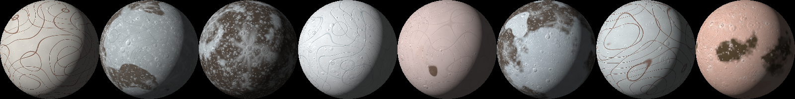
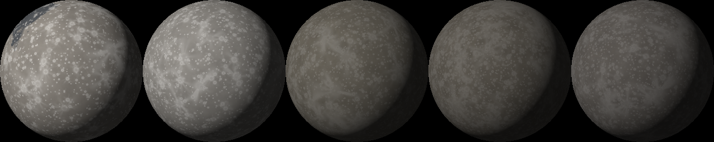

# Showoff

Planet looks, each baked on the CPU from its texture graph with simple lighting. The icy-moon and
lava-world bakes approximate relief with a slope term from the graph's `height` layer; the
captured-moon bake has none. The client lights relief with the shader's own relief path, and
draws air, haze and clouds on top.

## Icy moons

The icy look. Left to right: Europa, Ganymede, Callisto, Enceladus
and Triton from the measured table, then three generated moons: a cold Ganymede-sized one, a
tidally heated mid-sized one, and a small one at 40 K.

## Captured moons

The airless look. Left to right: Luna, a generated airless rock, then three captured moons with
the dark rubble preset.

## Lava worlds

The airless look with lava spreading as the surface melts. One generated scorched planet at
800, 1,100, 1,300 and 1,500 K.
